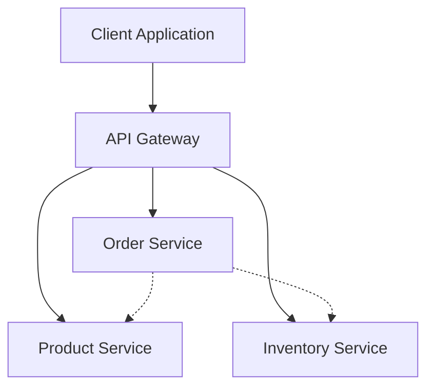

# Microservices-Based E-Commerce System

A backend project organized around a **microservices architecture**. The application is divided into independent services for product management, inventory management, and order processing, with an API Gateway serving as the entry point for client requests.

## Architecture Overview

The system consists of four main components:

| Component | Responsibility |
|---|---|
| API Gateway | Entry point for client requests and request routing. |
| Product Service | Handles product-related operations. |
| Inventory Service | Manages inventory and stock operations. |
| Order Service | Handles order-related operations. |

### Architecture Diagram



## Project Structure

```text
microservices/
│
├── _Product service/
│
├── api-gateway/
│   └── api-gateway/
│
├── inventory-service/
│   └── inventory-service/
│
├── order-service/
│   └── order-service/
│
└── .gitignore
```

## Learning Objectives

This project explores:

- Microservices architecture and service decomposition.
- API Gateway implementation and request routing.
- Separation of business responsibilities.
- Product and inventory management.
- Order processing.
- Communication between distributed services.
- Docker for publishing the the micro-services.

## Project Status

Work in progress.

## Author

**Ghada Dib**

[GitHub Profile](https://github.com/ghadaDib04)
